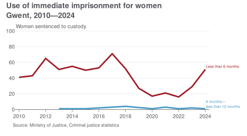
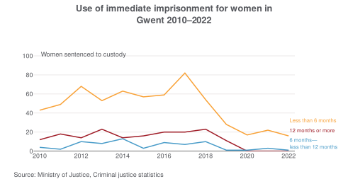

# Criminal Justice System statistics: data quality assurance

## Introduction
Processing the Outcomes by Offence datasets has highlighted differences between newly processed figures and previously published editions. Our checks have identified two separate issues, which are examined below.

The first concerns differences in offence, disposal and Police Force Area (PFA) groupings, particularly for data before 2017, following changes to the Ministry of Justice's data processing methods. These differences were identified and acknowledged in our 2025 analysis. The second is a discrepancy in 2017 custody figures, identified during code refactoring in preparation for the 2026 analysis, which was traced to missing records in an earlier Ministry of Justice dataset. This issue will be acknowledged in our 2026 analysis.

## Ministry of Justice processing changes and pre-2017 PFA differences
To understand differences between our newly processed data and earlier editions, we consulted the [Criminal Justice System statistics quarterly technical documentation](https://www.gov.uk/government/statistics/criminal-justice-system-statistics-quarterly-december-2022).

The appendix explains that since the Criminal Justice Statistics quarterly: December 2022 publication there has been a transition to more modern data processing methods, which have allowed the Ministry of Justice to resolve known issues in the tables and tools. Revised versions of the December 2022 edition interactive data tools were published in May 2023 "to ensure users have access to the revised figures for breakdowns by offence characteristics and offender demographics".

!!! quote "Technical appendix: Changes to the processing of criminal court sentencing data for Criminal Justice System Statistics Quarterly (CJSQ) publication"
    "Users should be aware that figures have been revised from 2017 onwards due to more accurate and reliable methods for data processing for information on prosecutions, convictions, sentencing and remands. **Additionally, we have made some improvements to ensure the consistency of groupings for offences,
    sentencing disposals and police force areas prior to 2017.**"

The transition to more modern data processing methods explicitly affects offence, disposal and police force area groupings for data pre-2017. [The appendix explains](https://assets.publishing.service.gov.uk/media/65bd02dd63a23d0013c8213a/criminal-justice-statistics-technical-appendix-june-2023.pdf#page=20) that the Ministry of Justice has "incorporated a new mapping between court code and Police Force Area to consistently map figures to their corresponding area" and that this has been applied to pre-2017 data as well.

### Examining the PFA differences
Discrepancies were particularly notable when visualising data on custodial sentence lengths for two of the four Welsh Police Force Areas (PFAs) — Dyfed-Powys and Gwent, which in some cases reported no cases of some sentence lengths for multiple years.

This was in contrast to our own previously published data, which included no such breaks during the time series.

Having checked figures on immediate custody for all four Welsh PFAs ['Dyfed-Powys', 'Gwent', 'North Wales', 'South Wales'], the totals between 2010–2016 are in line with the latest revised figures (±3 sentences).

*New edition*

| Police Force Area | 2010   | 2011   | 2012   | 2013   | 2014   | 2015   | 2016   |
| ------------------| ------ | -------| -------| ------ | ------ | ------ | -------|
| Dyfed Powys       | 22     | 33     | 25     | 26     | 18     | 19     | 19     |
| Gwent             | 41     | 43     | 65     | 52     | 56     | 51     | 55     |
| North Wales       | 74     | 72     | 94     | 100    | 91     | 109    | 117    |
| South Wales       | 359    | 374    | 331    | 392    | 399    | 365    | 432    |
| Grand Total       | 496    | 522    | 515    | 570    | 564    | 544    | 623    |

*Previous edition*

| Police Force Area | 2010   | 2011   | 2012   | 2013   | 2014   | 2015   | 2016   |
| ------------------| -------|--------|--------|--------|--------|--------|--------|
| Dyfed Powys       | 48     | 58     | 42     | 44     | 37     | 33     | 32     |
| Gwent             | 59     | 69     | 92     | 84     | 90     | 76     | 88     |
| North Wales       | 71     | 70     | 93     | 98     | 91     | 106    | 115    |
| South Wales       | 317    | 324    | 288    | 341    | 343    | 327    | 387    |
| Grand Total       | 495    | 521    | 515    | 567    | 561    | 542    | 622    |

However, there has been a redistribution away from Dyfed-Powys and Gwent towards South Wales, quite possibly to do with Crown Court availability and women being sentenced in a different PFA. This could also see some women in Gwent and Dyfed-Powys possibly being sentenced in England e.g. Gloucestershire, Devon, Merseyside, rather than in another Welsh PFA.

### Findings on the PFA differences
The redistribution between PFAs is consistent with the Ministry of Justice's documented changes to offence, disposal and PFA groupings; our checks found no evidence of a processing error. These pre-2017 differences were acknowledged in our 2025 analysis.

## 2017 custody data discrepancy
During code refactoring in preparation for the 2026 analysis, reprocessing the data showed that figures for 2017 were higher than those in our previously published custody tables. The difference affected all three custodial sentence tables. Initial checks against the [Ministry of Justice's Outcomes by Offence data tool](https://www.gov.uk/government/statistics/criminal-justice-system-statistics-quarterly-december-2024) indicated that the reprocessed figures were accurate, so we investigated whether the source CSV had changed. Unlike the pre-2017 PFA differences acknowledged in our 2025 analysis, this discrepancy will be acknowledged in our 2026 analysis.

We compared the CSV currently obtained through our data pipeline with an earlier copy of the dataset downloaded from the [National Archives web archive](https://webarchive.nationalarchives.gov.uk/ukgwa/20250522181645/https://www.gov.uk/government/statistics/criminal-justice-system-statistics-quarterly-december-2024). The earlier CSV contained 4,266,613 rows and the current CSV contained 4,317,508 rows, a difference of 50,895 rows. Comparing the files by year showed that all 50,895 additional rows were for 2017: the earlier file contained 551,989 rows for that year, compared with 602,884 in the current file. Row counts for 2018–2024 were identical.

The archived publication records indicate that the Ministry of Justice silently uploaded a revised zip file on [4 August 2025](https://webarchive.nationalarchives.gov.uk/ukgwa/20250804152033/https://www.gov.uk/government/statistics/criminal-justice-system-statistics-quarterly-december-2024), named `Outcomes_by_offence_2017_2024`, replacing the earlier `obo_2017_2024` file. The revised CSV has the same row counts as the current file. To check whether the earlier file explained our published figures, we repeated the relevant processing using it. The resulting totals for all custodial sentences, sentences of six months or less, and sentences of 12 months or less matched our previously published totals. This confirms that the discrepancy arose because the earlier Ministry of Justice dataset was missing 50,895 records for 2017, rather than from an error in our processing.

## Summary and publication implications
The two issues have different explanations and publication histories. The 2010–2016 PFA differences are consistent with documented Ministry of Justice processing and mapping changes and were acknowledged in our 2025 analysis. The 2017 custody discrepancy arose because an earlier Ministry of Justice dataset omitted 50,895 records for that year; it was identified in preparation for the 2026 analysis and will be acknowledged in that analysis.

The 2017 discrepancy should be explained in the 2026 publication notes so users can understand why figures differ from earlier editions. The 2010–2016 PFA redistribution should also be considered when deciding how to present those figures.